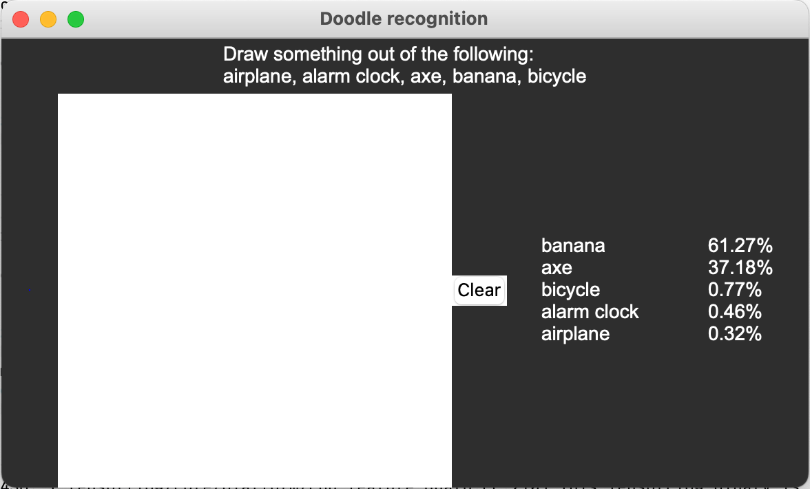
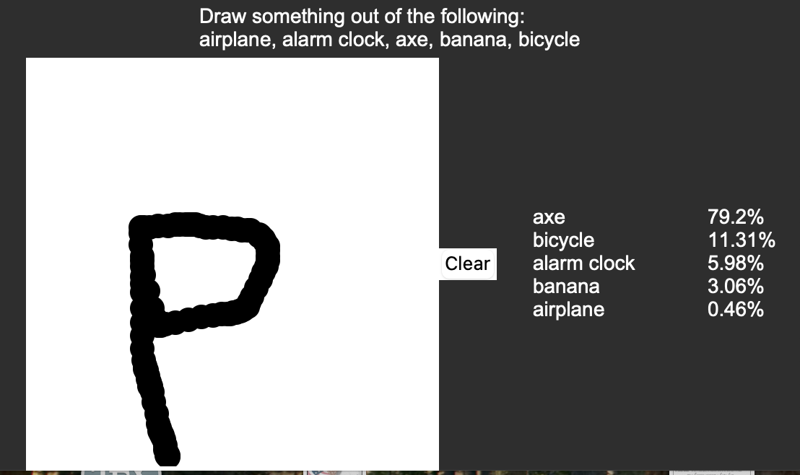
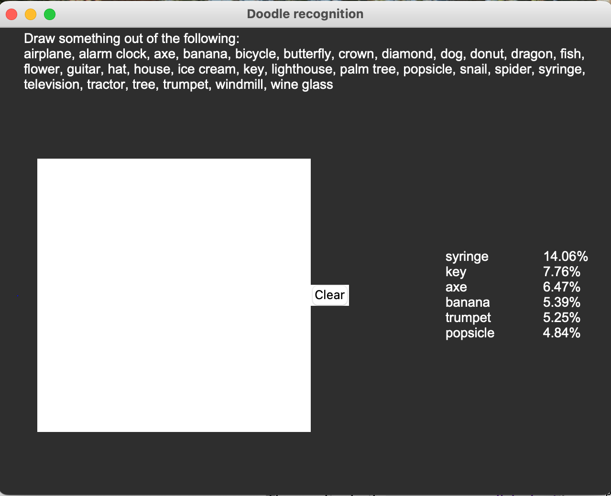
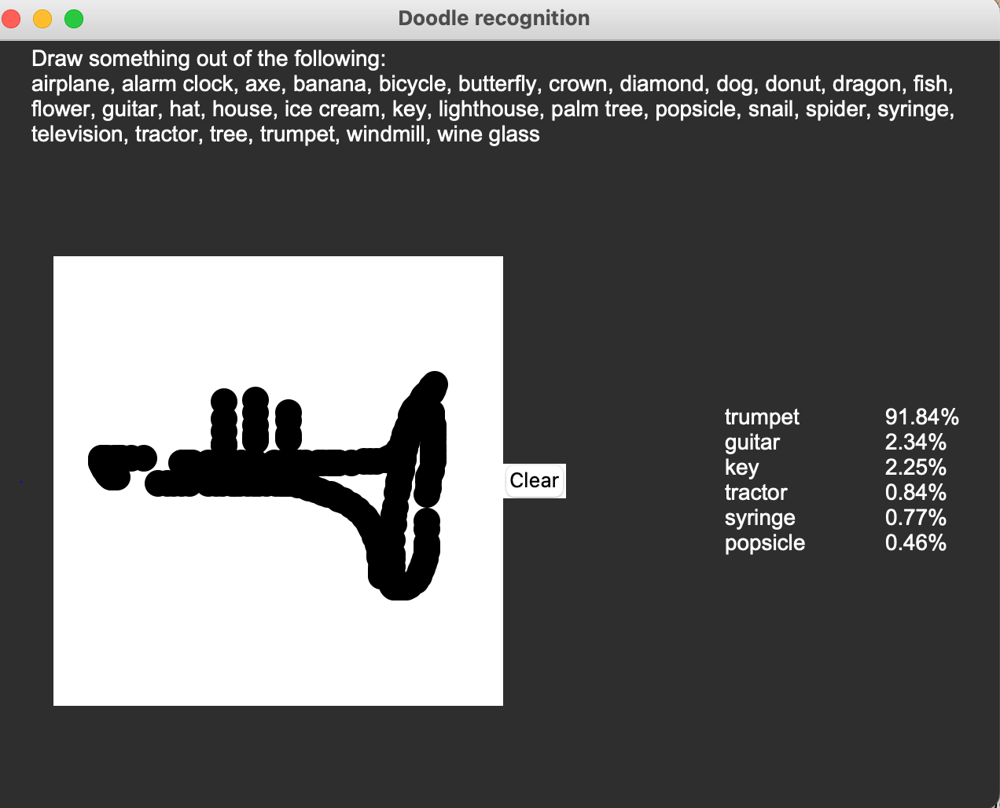

# Doodle Prediction

A machine learning project that classifies hand-drawn doodles using Convolutional Neural Networks (CNN) and Principal Component Analysis (PCA) with fully connected networks.

**Authors:** Simon Ruhland and William Clark

## Dataset

This project uses the ['Quick, Draw!' dataset](https://quickdraw.withgoogle.com/data), which contains 50 million doodles submitted from around the world across 345 categories.

**Our subset:**
- 30 handpicked categories (e.g., airplane, alarm clock, axe, banana, bicycle, blueberry, elbow)
- Approximately 3GB of data
- ~150,000 grayscale images per category
- Image dimensions: 28×28 pixels

## Minimal Working Example (5 category classifier)

By the end of this minimal example, you will have
opened up a sketchpad with an embedded CNN-based classifier
which can predict sketches of 5 categories of doodles. 
Later on, you will be able to use classifiers which 
can handle 30 categories and who rely on a PCA dimensionality reduction
and fully connected neural network.

Prerequisite: 
Make sure your Python build has Tkinter support. 
Test this by running: 
`python3 -m tkinter`

If a small GUI box doesn't show up, run
`sudo apt update`
Then
`sudo apt install python3-tk`

Once you check that tkinter is supported, 
it is time to clone this repo using 
`git clone https://github.com/williamclarktennis/public-mllab-doodle-project.git`

Then create a virtual environment:
`python3 -m venv .venv`

Then activate it: 
`source .venv/bin/activate`

Then install the dependencies:
`pip install -r requirements.txt`

Then open up the python interpreter:
`python3`

Then get run the following 
lines inside the python interpreter:
```
>>> import neural_network as NN
>>> five_cat_model = NN.create_model_for_test(5) 
>>> five_cat_model.load_weights('weights/five_cat_model.weights.h5')
>>> import tkinter as tk
>>> root = tk.Tk()
>>> import UI
>>> app = UI.DrawingApp(root, num_categories=5, model = five_cat_model)
```



Then draw a doodle of one of the five categories. 



## Variations of the Minimal Example

Inside `Presentation.ipynb`, you can find other routines. 
Let's look at one for classifying 30 doodles using a CNN.

```
>>> import neural_network as NN
>>> thirty_cat_model = NN.create_model_for_test(30)
>>> thirty_cat_model.load_weights('weights/thirty_cat_model.weights.h5')
>>> import tkinter as tk
>>> root = tk.Tk()
>>> import UI
>>> app = UI.DrawingApp(root, num_categories=30, model = thirty_cat_model)
```



Then pick any of the categories and doodle it. 
Try to draw it generically and see if the CNN can classify it.




## Methodologies behind the classifiers

### Approach 1: Convolutional Neural Network (CNN)

#### Architecture

- **Input layer:** Shape (28, 28, 1)
- **Conv2D layer 1:** 16 filters, (3,3) kernel, ReLU activation
- **Conv2D layer 2:** 32 filters, (3,3) kernel, ReLU activation
- **MaxPooling2D layer**
- **Fully connected layer:** 128 nodes, ReLU activation
- **Output layer:** Softmax activation (number of nodes = number of categories)

#### Loss Function

Categorical crossentropy:

```
min_f { -Σ_i log(σ(f)_i) }
```

Where σ(f)_i = exp(f_i) / Σ_j exp(f_j) produces a probability distribution.

#### Training Results

| Categories | Training Images | Training Time |
|-----------|----------------|---------------|
| 5         | 45,000         | ~minutes      |
| 10        | 90,000         | ~minutes      |
| 20        | 180,000        | ~minutes      |
| 30        | 960,000        | 1.5 hours     |

### Approach 2: PCA + Fully Connected Neural Network

To reduce dimensionality and explore alternative approaches, we applied Principal Component Analysis.

#### PCA Configuration

- Training categories: airplane, alarm clock, axe, banana, bicycle
- **200 principal components** selected (out of maximum 784)
- Explains ~90% of variance
- Visualized "eigendoodles" show the principal components as interpretable doodle features

#### Neural Network Architecture (PCA-transformed data)

- **Input layer:** 200 nodes (principal components)
- **Hidden layer 1:** 128 nodes, ReLU activation
- **Dropout:** 20% (training only)
- **Hidden layer 2:** 128 nodes, ReLU activation
- **Dropout:** 20% (training only)
- **Output layer:** 5 nodes, Softmax activation

## Results

The CNN achieved strong performance across all category counts, with training time scaling approximately linearly with dataset size. The PCA approach successfully reduced dimensionality while maintaining ~90% variance, demonstrating that lower-dimensional representations can still capture essential doodle features.

## Requirements

- TensorFlow/Keras
- NumPy
- Matplotlib
- scikit-learn (for PCA)
- tkinter (for UI)

## Acknowledgments

Dataset: [Google's Quick, Draw!](https://quickdraw.withgoogle.com/data)
